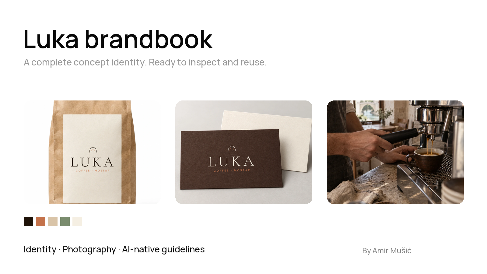

# Luka brandbook

A complete concept identity by **Amir Mušić**. Logo, type, colour, photography, applications and AI-native production guidelines in one reference.

**[Open the brandbook](https://amirmushichge.github.io/luka-brandbook/)** · **[Download the complete kit](https://github.com/amirmushichge/luka-brandbook/releases/latest/download/luka-brand-kit.zip)** · **[Download the offline HTML](https://github.com/amirmushichge/luka-brandbook/releases/latest/download/luka-brandbook.html)**

## What you get

| File | Use |
| --- | --- |
| `index.html` | Read in your browser. Images and fonts are embedded; it also works offline. |
| `assets/luka-logo-full.svg` | The master lockup: arch, wordmark and descriptor. All SVG logos use outlined artwork. |
| `assets/*reference.png` | Transparent logo exports for tools that accept raster inputs. |
| `assets/*.webp` | Concept photography and branded application references. |
| `luka-brand.json` | A compact brand packet for agents and production tools. |
| `fonts/` | Cormorant Garamond and DM Sans, including italic files and original OFL licenses. |
| `LOGO-INTEGRITY.md` | How to preserve source artwork through production. |

## Use the kit

1. Open the HTML to understand the identity and its production rules.
2. Supply the relevant brand references, exact logo and a specific task brief to your tool.
3. Check the result against the source. Replace a generated logo redraw with the master SVG before delivery.

The AI-native section separates fixed brand assets, task requirements, generated scene content and release checks. The kit contains the finished reference and source identity assets. The brandbook generation system is a separate project.

Luka is a fictional café concept in Mostar. Photographs and mockups are generated concept illustrations, not records of an operating business.

## Reuse and attribution

Guidelines, prose and original creative assets are shared under **[CC BY 4.0](LICENSE)**. Commercial use and adaptations are allowed with attribution, a license link and an indication of changes. HTML/CSS/JavaScript is under **[MIT](LICENSE-CODE)**. Fonts retain their **SIL Open Font License 1.1**, included per family in `fonts/`.

Suggested credit: **“Luka concept identity by Amir Mušić — CC BY 4.0.”** Link to this repository and identify your changes. Attribution does not imply Amir's endorsement.

### Edition

**1.3.2** adds embedded offline fonts, their licenses and a clean downloadable kit to the approved visual edition. The source logo artwork is unchanged.

By [Amir Mušić](https://github.com/amirmushichge).
